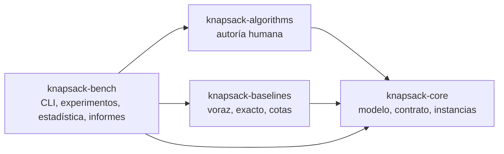
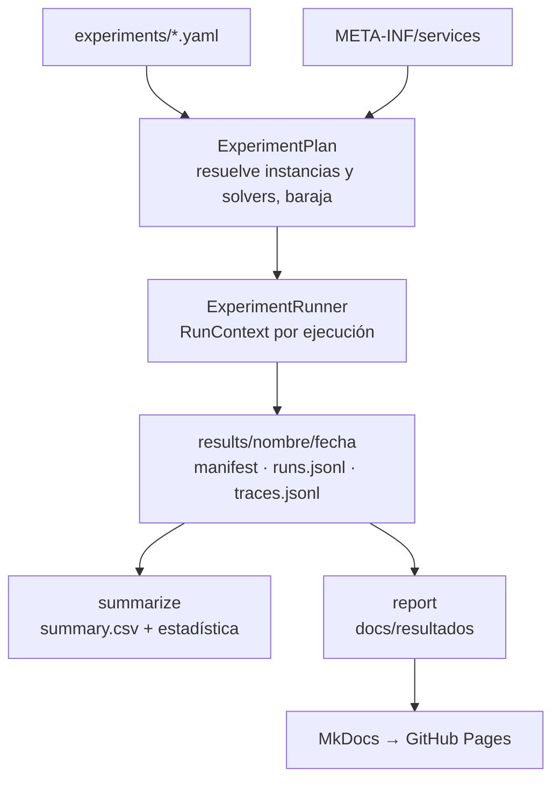

# Arquitectura

## Módulos

| Módulo | Paquetes | Contenido |
|---|---|---|
| `knapsack-core` | `org.dmorfav.knapsack.core` | `Instance`, `Item`, `Solution` y `Evaluation` |
| | `…core.solver` | Contrato: `KnapsackSolver`, `SolverInfo`, `SolverContext`, `RunContext`, `Budget` y `TracePoint` |
| | `…core.io` y `…core.generator` | Formato JSON de instancias y generador de Pisinger |
| | `model`, `kp_hs` | Modelo del proyecto original, que conserva su paquete porque los algoritmos originales lo importan |
| `knapsack-algorithms` | `algorithms` | Algoritmos de autoría humana |
| `knapsack-baselines` | `org.dmorfav.knapsack.baselines` | Voraces, programación dinámica y cota de Dantzig |
| `knapsack-bench` | `…bench.cli` | Subcomandos de la línea de comandos (picocli) |
| | `…bench.experiment` | Definición, planificación y ejecución de experimentos, y formato de resultados |
| | `…bench.stats` | Resúmenes y pruebas estadísticas |
| | `…bench.report` | Páginas de resultados para esta web |
| | `…bench.legacy` | Adaptadores de los algoritmos originales al contrato |

`knapsack-algorithms` y `knapsack-baselines` solo dependen de `knapsack-core`. Un algoritmo no puede ver el runner, las referencias ni otros algoritmos.

## Flujo de un experimento

## Publicación de resultados

Los resultados no se guardan en la rama `main`. Un workflow semanal de GitHub Actions hace lo siguiente:

1. Ejecuta los experimentos.
2. Guarda las carpetas de resultados en la rama `results`.
3. Regenera las páginas con `report` y publica la web en GitHub Pages.

Cualquier cambio de la documentación en `main` vuelve a publicar la web con los resultados existentes.
